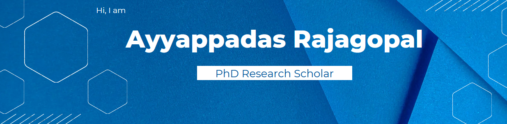

<!-- Profile README -->
<!--
<p align="center">
  
</p>
-->
👋 Hello! I'm
<h1 align="center">
   <a href="https://www.ayyappadasrajagopal.com/">Dr. Ayyappadas Rajagopal</a>
</h1>

<p align="center">
  <a href="https://www.linkedin.com/in/ayyappadasrajagopal/"></a>
  <a href="https://ayyappadasrajagopal.github.io"></a>
  <a href="https://www.ayyappadasrajagopal.com/"></a>
  <a href="mailto:ayyappadas.r.nair@gmail.com"></a>
</p>

<p align="center">
  
</p>


<p align="center">
  
</p>

---

### 🧑‍🔬 About Me

🔬 **Postdoctoral Research Fellow at Singapore Institute of Technology (SIT), Singapore**<br>
🎓 **PhD in Electrical Engineering** from **IIT Palakkad**, India<br>
🌐 Currently exploring **Quantum Networks**, **Quantum Key Distribution (QKD)**, **Measurement-Device-Independent QKD (MDI-QKD)**, and **Quantum-Secure Communication**<br>
🧠 Passionate about **Networked Control Systems**, **Estimation & Control**, and **Cyber-Physical Systems**<br>
🤖 Bridging the gap between **theory and real-world systems** through **hardware-in-the-loop (HIL)** implementations and **applied algorithms**<br>
🧪 Exploring **Artificial Intelligence**, **Reinforcement Learning**, and **Machine Learning** for intelligent decision-making in autonomous systems<br>
📐 Applying **Deep Learning** and **Advanced Optimization** techniques to solve complex engineering challenges

---
### 🔬 Research Focus

> *"Empowering intelligent systems through quantum-secure communication, resilient control, and advanced AI."*

| Area | Description |
|------|-------------|
| 🌐 **Quantum Networks & Communication** | Design and optimization of **quantum networks**, focusing on secure communication, network architectures, and resource-efficient quantum connectivity |
| 🔐 **Quantum Key Distribution (QKD)** | **Discrete-variable QKD**, decoy-state protocols, **Measurement-Device-Independent QKD (MDI-QKD)**, and finite-key security analysis |
| 📡 **Networked Control Systems** | State estimation and optimal control under **uncertain communication channels, network-induced delays, and packet dropouts** |
| 🔄 **Reinforcement Learning (RL)** | **Model-free and model-based RL** for robust, adaptive control and intelligent decision-making in dynamical systems |
| 🧠 **Machine Learning (ML)** | **Supervised, unsupervised, and semi-supervised learning** for data-driven system modeling, prediction, and anomaly detection |
| 🤖 **Artificial Intelligence (AI)** | **AI-driven autonomy** — intelligent decision-making, planning, and perception for cyber-physical systems and autonomous robotics |
| 🧬 **Deep Learning & Neural Networks** | **Deep RL (DQN, PPO, SAC)** and recurrent architectures (**LSTM, Transformers**) for sequential decision-making, system identification, and time-series prediction |
| 🛡️ **Cyber-Physical Systems Security** | Security and resilience of **cyber-physical systems** using adversarial machine learning, anomaly detection, and intrusion detection |
| 🧪 **Hardware-in-the-Loop (HIL) Testbeds** | Real-time implementation and experimental validation of theoretical models, estimation algorithms, and control strategies |
| 📊 **Advanced Optimization** | **Convex and non-convex optimization, stochastic programming, and metaheuristic algorithms** for complex, large-scale networked systems |

---

### 🚀 What I'm Working On

```text
🌐  Investigating the optimization and resource allocation of quantum-secure networks
🔐  Developing optimization frameworks for shareable measurement-device-independent QKD (MDI-QKD) networks
📡  Exploring optimal deployment, positioning, and resource allocation of untrusted measurement nodes in quantum networks
🛠  Building robust estimation and control frameworks under network-induced delays, packet dropouts, and channel uncertainties
🤖  Applying deep reinforcement learning (DRL) for adaptive control and intelligent decision-making in uncertain environments
🧠  Exploring AI and machine learning techniques for autonomous systems and cyber-physical system intelligence
📈  Investigating transfer learning and domain adaptation for cross-platform CPS deployment
🔬  Exploring physics-informed neural networks (PINNs) and learning-based approaches for system identification
📊  Developing advanced optimization algorithms for complex network design and resource allocation problems
📜  Preparing research manuscripts, scientific publications, and intellectual property contributions
```
---
### 🛠️ Tech Stack & Tools

**🔬 Engineering, Simulation & Research**

\<p align="center">   \   \   \   \ \</p>

**💻 Programming Languages**

\<p align="center">   \   \   \ \</p>

**🤖 Robotics & Autonomous Systems**

\<p align="center">   \   \ \</p>

**🧠 Artificial Intelligence & Machine Learning**

\<p align="center">   \   \   \   \   \ \</p>

**📊 Scientific Computing & Data Analysis**

\<p align="center">   \   \ \</p>

**⚙️ Development & Version Control**

\<p align="center">
&#x20; \
&#x20; \
\</p>

---


### 🧠 AI, Machine Learning & Reinforcement Learning Research

> *"At the intersection of learning algorithms and physical systems lies the future of autonomy."*

#### 🔄 Reinforcement Learning (RL)
- **Model-Free RL**: Deep Q-Networks (DQN), Proximal Policy Optimization (PPO), Soft Actor-Critic (SAC) for continuous control tasks
- **Model-Based RL**: Learning environment dynamics for sample-efficient planning in robotics and networked systems
- **Multi-Agent RL (MARL)**: Cooperative and competitive strategies for distributed cyber-physical systems
- **Safe RL**: Constrained optimization to ensure safety guarantees in safety-critical systems

#### 🤖 Machine Learning (ML)
- **Supervised Learning**: Regression and classification for sensor fusion, fault detection, and predictive maintenance
- **Unsupervised Learning**: Clustering and dimensionality reduction for pattern discovery in large-scale system data
- **Time-Series Forecasting**: LSTM, Transformer, and attention-based models for network traffic and system state prediction
- **Anomaly Detection**: ML-driven intrusion detection and anomaly identification in cyber-physical systems

#### 🧬 Advanced AI & Deep Learning
- **Physics-Informed Neural Networks (PINNs)**: Embedding physical laws into neural architectures for system identification
- **Graph Neural Networks (GNNs)**: Modeling networked control topologies and communication graphs
- **Transfer Learning & Domain Adaptation**: Cross-platform generalization for CPS controllers
- **Generative Models**: VAEs and diffusion models for synthetic data generation and simulation environments
- **Neural Ordinary Differential Equations (Neural ODEs)**: Continuous-depth models for dynamical system learning

---

### 💬 Ask Me About

<table>
  <tr>
    <td>📊 Estimation under uncertainty</td>
    <td>🎛️ Control theory & real-time applications</td>
  </tr>
  <tr>
    <td>🔐 Cyber-physical systems</td>
    <td>📝 Research publishing & academia-industry collaboration</td>
  </tr>
  <tr>
    <td>🤖 Reinforcement learning for control</td>
    <td>🧠 Deep learning & neural network architectures</td>
  </tr>
  <tr>
    <td>📈 ML-driven system modeling</td>
    <td>🧬 AI for autonomous & safety-critical systems</td>
  </tr>
</table>

---

### 📊 GitHub Stats

<p align="center">
  
  
</p>

<p align="center">
  
</p>

---

### 📫 Get in Touch

<p align="center">
  <a href="https://ayyappadasrajagopal.github.io">🌐 Portfolio Website</a> •
  <a href="mailto:122004004@smail.iitpkd.ac.in">📧 Official Email</a> •
  <a href="mailto:ayyappadas.r.nair@gmail.com">📧 Personal Email</a> •
  <a href="https://www.linkedin.com/in/ayyappadasrajagopal/">💼 LinkedIn</a> •
  <a href="https://www.ayyappadasrajagopal.com/">🌍 Personal Website</a>
</p>

---

### ⚡ Fun Fact

> I love blending **modern Control Theory** with **Artificial Intelligence**, **Reinforcement Learning**, and **advanced Communication Systems** to build **smarter, safer, and self-learning cyber-physical systems** 🚀

---

<p align="center">
  
</p>

<p align="center">
  ⭐ If you find this interesting, do star and fork! 🍴
</p>

<p align="center">
  <i>Let's connect and build the future of AI-powered intelligent control systems together!</i>
</p>
